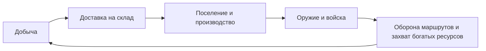

# Lords of the Valley — Game Design Document

Версия: 1.23

Дата: 10 ноября 2026

Статус: актуальный дизайн одиночной песочницы и последующих этапов

Документ описывает целевой дизайн. Наличие механики в GDD не означает, что она уже полностью реализована и проверена в сцене. Текущий статус указан в разделе 16. Стоимости, времена и стартовые запасы в таблицах — ориентиры баланса; значения Inspector, префабов и базы построек могут отличаться. Параметры, явно названные текущими значениями кода, также могут переопределяться в сцене.

## 1. Концепция

**Lords of the Valley** — средневековая RTS для четырёх игроков на одной общей карте. Игрок развивает поселение, добывает ресурсы, физически перевозит их, производит оружие, обучает жителей, торгует, заключает союзы и воюет.

Партия рассчитана примерно на один час. Побеждает последний оставшийся игрок либо последний оставшийся союз.

Первой создаётся одиночная песочница. В ней игрок один развивает поселение, добывает и перевозит ресурсы, строит, производит вооружение, собирает армию, отражает разбойников и осаждает лагеря. Эта версия нужна для проверки экономики, логистики, боя и баланса. Мультиплеер на четырёх игроков, торговля и дипломатия добавляются после того, как одиночная песочница станет стабильной и полностью играбельной.

Главная особенность игры — физическая логистика. Добыча, строительные материалы, оружие, еда, торговые товары и трофеи существуют в мире как грузы. Их нужно доставить на склад, чтобы использовать. Убийца работника или уничтожитель повозки забирает перевозимый груз, но тоже обязан довезти его на свой склад.

## 2. Основные правила

- Экономика и война имеют равное значение.
- Четыре игрока начинают в разных частях одной большой карты.
- Карта, все юниты и все здания игроков видны с начала партии. Тумана войны нет.
- Рядом с каждым поселением есть небольшие запасы дерева, камня, железа и золота.
- Богатые источники находятся между поселениями. Они общедоступны и не имеют владельца.
- Рабочие начинают добычу сразу, но противник может убить их и поставить своих.
- Жители приходят автоматически, если есть свободное жильё.
- Войска обучаются из свободных жителей, поэтому армия и экономика используют один запас населения.
- Набеги разбойников и засады на повозки создают внешнюю угрозу.
- Дороги бесплатны. Для работы обычного здания нужен подъезд к входу; соединять его дорогой с центральным складом не обязательно.
- Дорога влияет на выбор маршрута, но не увеличивает скорость передвижения.

### 2.1 Принадлежность

В одиночной песочнице используются три стороны: **Player**, **Bandits** и **Neutral**. Принадлежность задаётся отдельно от профессии и настройки автоматической атаки.

Игрок управляет своими юнитами и открывает панели своих зданий. Бойцы автоматически выбирают врагов, не атакуют своих; добыча нейтральных животных и ресурсов остаётся рабочим взаимодействием. Найм, ремонт, склады, таверны, снабжение и привязка лошади учитывают сторону владельца. Смена профессии, обучение и роспуск сохраняют принадлежность человека.

Природные источники ресурсов не принадлежат игрокам. Захват поселений, передача собственности и дипломатические союзы — отдельные будущие механики. Система трёх сторон пока не заменяет сетевых владельцев четырёх игроков.

## 3. Игровой цикл

Стартовые залежи покрывают первые 10–15 минут развития. Затем игроку нужно добывать ресурсы на спорных территориях, защищать носильщиков, строить армию, торговать или уничтожать ратуши противников.

## 4. Ресурсы

| Ресурс | Источник | Применение |
|---|---|---|
| Дерево | лес | здания, стены, луки, щиты, копья, лестницы |
| Камень | каменоломня | укрепления и капитальные здания |
| Железо | шахта | мечи, копья, катапульты |
| Золото | золотая шахта, лагерь разбойников | лошади, рынок, дорогие постройки |
| Пшеница | ферма | переработка в муку |
| Мука | мельница | выпечка хлеба |
| Хлеб | пекарня | жители, войска, снабжение армии |
| Еда | рыбалка, охота, ягоды | жители, войска, снабжение армии |
| Меч | кузница | мечник, кавалерист |
| Копьё | кузница | копейщик |
| Лук | мастерская | лучник |
| Щит | мастерская | мечник и копейщик |
| Лошадь | конюшня | кавалерист |

### 4.1 Источники ресурсов

| Источник | Стартовый запас | Богатый запас | Восстановление |
|---|---:|---:|---|
| Лес | 300 дерева | 1 200 дерева | 10% раз в 5 минут |
| Камень | 150 камня | 600 камня | нет |
| Железо | 100 железа | 400 железа | нет |
| Золото | 50 золота | 200 золота | нет |
| Ягоды | 300 еды | 900 еды | конечный запас, автоматическое восстановление не предусмотрено |
| Охота | 400 еды | 1 200 еды | конечное число животных; возрождение пока не предусмотрено |
| Рыба | постоянный источник | постоянный источник | не истощается |

Каждое отдельное дерево даёт **20 дерева**, отдельная залежь камня — **15 камня**, железная жила — **10 железа**, золотая жила — **5 золота**. Это небольшие единицы добычи: лесоруб или шахтёр не забирает целое месторождение за один подход.

Эти значения — стартовый баланс прототипа. Они меняются после игровых тестов.

Животные перемещаются по карте. После смерти остаётся запас мяса; животное удаляется после полного сбора мяса.

## 5. Логистика

### 5.1 Добыча и доставка

Добытчик нанимается в своём рабочем здании, ищет подходящий источник, добывает ресурс в рюкзак и возвращает добычу в локальный запас своего здания. Затем носильщик забирает её и физически доставляет на склад. Рабочий мельницы, пекарни, кузницы или мастерской занимается производством; сырьё доставляет носильщик.

Носильщики автоматически выбирают задания «забрать» и «доставить», резервируют конкретный груз и свободное место назначения. Один заказ не должен одновременно доставаться двум носильщикам. Панель выбранного работника показывает текущую задачу и груз; текст задачи не обязан содержать название объекта.

Игрок назначает зданиям приоритет доставки: низкий, обычный, высокий или срочный.
Носильщики сначала берут выполнимые заявки более высокого уровня независимо от типа здания;
недоступная срочная заявка не блокирует остальные. Уже начатые доставки завершаются с сохранением резервов.
Для доставки еды и сырья используется приоритет получателя, для вывоза продукции — здания-источника.
По умолчанию все здания имеют обычный уровень. Настройка: [Delivery_Priority_Setup.md](../Delivery_Priority_Setup.md).

| Перевозчик | Вместимость | Задача |
|---|---:|---|
| Носильщик | 10 единиц | добыча → склад |
| Строитель | 10 единиц | склад → стройка |
| Торговая повозка | 50 единиц | рынок → рынок другого игрока |
| Снабженческая повозка | 50 еды | склад → армия |
| Осадная повозка | 2 лестницы | мастерская → вражеская стена |

Работники склада автоматически забирают готовое оружие из производственных зданий, переносят его на склад и доставляют снаряжение к зданиям обучения, когда там есть заказ.

### 5.2 Грабёж

При гибели работника или повозки груз переходит юниту, нанёсшему последний удар. Если у него нет места, груз получает ближайший союзный воин с местом в инвентаре в радиусе 5 метров. Если такого юнита нет, груз теряется.

Захваченное нельзя потратить немедленно: новый владелец должен доставить груз на свой склад.

### 5.3 Строительство

Стройплощадка размещается, только если на складе есть полная стоимость здания. Ресурсы сразу резервируются. Строители переносят их на стройку, затем возводят здание.

Резерв закреплён за конкретными своими складами, а не списывается мгновенно из общего счётчика. Строитель может переносить несколько типов материалов в пределах вместимости. Прогресс строительства разрешён только после доставки всех необходимых материалов. После стройки свободные строители ремонтируют повреждённые здания своей стороны; текущий прототип ремонта бесплатный.

Если строитель погибает с материалами, они могут быть захвачены. Владелец должен восполнить потерю, чтобы строительство продолжилось. Отмена стройки возвращает только материалы, которые ещё не покинули склад.

На одной стройке работают до трёх строителей. Первый работает со 100% скоростью, второй добавляет 60%, третий — 40%.

Это целевая схема эффективности. Число строителей и фактическую скорость текущей площадки задают её настройки; указанные коэффициенты нельзя считать уже подтверждёнными реализацией.

### 5.4 Дороги и подъезды

- Свободная прокладка по контрольным точкам с плавными поворотами, без оплаты ресурсами.
- Назначенный Road Prefab задаёт внешний вид новых дорог. Без него генерируется стандартное покрытие.
- Для привязки к зданию используется назначенный Connection Point, затем дочерний объект **SnapPoint**, затем прежняя точка входа или край коллайдера.
- SnapPoint определяет точное подключение по горизонтали; его локальная ось Z направлена наружу. Высота дороги берётся с земли. Допускается заход торца внутрь коллайдера подключаемого здания.
- Достаточно дороги у входа. При отсутствии подъезда приостанавливаются зависящие от него производство, найм, обучение и обслуживание грузов/питания; запасы и заказы сохраняются.
- Юниты предпочитают дороги при поиске пути. Дополнительного множителя скорости на дороге нет.

## 6. Население, работа и еда

### 6.1 Жители

Один дом вмещает 5 жителей. При свободном месте, запасе свыше 20 еды и отсутствии голода новый житель приходит раз в 45 секунд.

Профессия назначается через здание кнопкой «Нанять». Ближайший свободный житель становится работником этого здания. Увольнение снова делает его свободным.

| Профессия | Здание | Задача |
|---|---|---|
| Лесоруб | лесопилка | добывает дерево |
| Каменщик | каменоломня | добывает камень |
| Шахтёр | шахта | добывает железо или золото |
| Фермер | ферма | выращивает пшеницу |
| Рыбак | рыболовная хижина | ловит рыбу |
| Охотник | охотничья хижина | добывает мясо |
| Собиратель | пункт сбора ягод | собирает ягоды |
| Носильщик | склад | автоматически перевозит грузы |
| Строитель | строительная артель | доставляет материалы и строит |
| Мельник | мельница | производит муку из доставленной пшеницы |
| Пекарь | пекарня | производит хлеб из доставленной муки |
| Кузнец | кузница | производит мечи и копья |
| Ремесленник | мастерская | производит снаряжение по заказам |

### 6.2 Еда и голод

Жители и солдаты в поселении едят в таверне. Носильщик доставляет туда съедобные продукты со своего склада. Пополнение начинается при снижении запаса ниже выбранного порога и продолжается до вместимости с учётом резервов. Хлеб, рыба, мясо и ягоды считаются едой; пшеница и мука сами по себе не утоляют голод.

Голодный юнит самостоятельно подходит к точке выдачи, получает реальную порцию и ест с анимацией `isEating`. Общего мгновенного списания еды через UnitManager нет. Питание не перехватывает активный боевой приказ или приказ игрока. При удержании H вне боя разрешается перерыв на еду с возвратом на позицию.

Голод рассчитывается отдельно для каждого юнита. Текущие значения по умолчанию в UnitEat: отсрочка до урона **120 секунд**, затем **10 HP каждые 20 секунд**. Случайный житель не выбирается: погибает конкретный юнит, исчерпавший здоровье. Поиск еды и прерывание приказом не перезапускают отсрочку. Интервал питания, размер порции и урон настраиваются отдельно.

| Источник еды | Скорость | Условие |
|---|---:|---|
| Ферма | 5 пшеницы/мин. | строится на плодородной земле |
| Мельница | 5 пшеницы → 5 муки/мин. | строится в поселении |
| Пекарня | 5 муки → 5 хлеба/мин. | строится в поселении |
| Рыболовная хижина | 4 еды/мин. | строится у воды |
| Охотничья хижина | 4 еды/мин. | строится у животных |
| Пункт сбора ягод | 3 еды/мин. | строится у ягодника |

### 6.3 Снабжение армии

Вблизи поселения солдаты пользуются таверной. При удалении от своей таверны переключаются на походное питание; текущий базовый радиус поселения — 60 м с гистерезисом 10 м. Порог и радиус снабжения настраиваются.

Игрок назначает солдат в армию и привязывает к ней снабженческую повозку. Повозка физически загружается у своего склада, пополняет запас и сопровождает армию или выделенную охрану. Солдат должен добраться до выдачи порции в пределах правил снабжения; еда не начисляется удалённо из общего склада.

Движение повозки разрешено только при живой привязанной лошади своей стороны. Без лошади доступный запас еды остаётся в повозке. Отсутствие повозки, еды, лошади или доступного радиуса отображается предупреждением. Голод использует индивидуальную отсрочку и урон из раздела 6.2.

## 7. Здания

### 7.1 Экономика

| Здание | Стоимость | Роль | Мест |
|---|---|---|---:|
| Ратуша | стартовое | центр поселения и цель набегов. В мультиплеере уничтожение означает поражение | 0 |
| Дом | 10 дерева | жильё | 5 |
| Склад | 25 дерева, 10 камня | хранение, носильщики, снабжение | 4 |
| Строительная артель | 20 дерева, 5 камня | строители | 4 |
| Лесопилка | 15 дерева | лесорубы | 3 |
| Каменоломня | 20 дерева, 5 камня | каменщики | 3 |
| Шахта | 20 дерева, 10 камня | шахтёры | 3 |
| Ферма | 15 дерева | фермеры | 2 |
| Мельница | 20 дерева, 5 камня | переработка пшеницы в муку | 2 |
| Пекарня | 20 дерева, 5 камня | выпечка хлеба из муки | 2 |
| Рыболовная хижина | 15 дерева | рыбаки | 2 |
| Охотничья хижина | 10 дерева | охотники | 2 |
| Пункт сбора ягод | 5 дерева | собиратели | 2 |
| Таверна | настраивается в базе построек | физическая выдача доставленной еды | не жильё |
| Больница | 40 дерева, 20 камня | автоматическое лечение раненых солдат с расходом еды | 4 койки по умолчанию, не жильё |
| Рынок | 35 дерева, 15 камня, 10 золота | торговые повозки и обмен | 0 |
| Порт | 40 дерева, 20 камня | склад на 300 товаров, погрузка/разгрузка через панель корабля, ремонт и авторейсы; международная торговля позже | до 3 портовых рабочих, не жильё |

### 7.2 Производство и армия

| Здание | Стоимость | Роль |
|---|---|---|
| Кузница | 25 дерева, 10 камня | мечи и копья |
| Мастерская | 30 дерева, 10 камня | луки, щиты, лестницы, катапульты |
| Казарма | 35 дерева, 15 камня | мечники и копейщики |
| Стрельбище | 30 дерева, 10 камня | лучники |
| Конюшня | 40 дерева, 20 камня, 10 золота | производство отдельных лошадей для кавалерии и повозок |
| Судостроительная верфь | 60 дерева, 30 камня, 10 железа | производство торговых, транспортных и боевых корпусов |

### 7.3 Оборона

| Здание | Стоимость | Прочность | Роль |
|---|---|---:|---|
| Стена, сегмент | 3 дерева, 2 камня | 500 HP | гарнизон до 6 юнитов |
| Ворота | 10 дерева, 8 камня | 700 HP | проход через стену |
| Башня | 15 дерева, 15 камня | 600 HP | вход на стену, гарнизон до 4 лучников |

Лучники могут стоять на стенах и в башнях. Башня без лучников не стреляет. Защитники поднимаются на стены только через башни.

### 7.4 Порт и судостроительная верфь

**Порт: добавлен код локального склада на 300 единиц, товарного трюма на 200, найма портовых рабочих, погрузки/разгрузки партиями и доставки носильщиками.** Текущая реализация обслуживает один причал и одну грузовую операцию за раз; второй причал остаётся целевым расширением. Полная проверка в Play Mode ещё требуется. Настройка: [Port_Cargo_Setup.md](../Port_Cargo_Setup.md).

**Статус: добавлен код производства корпусов на верфи, найма корабельщиков и проверки места спуска.** Есть команды Editor для создания тестовых префабов. Добавлены водные маршруты, швартовка с резервом одного причала, экипаж из жителей и питание припасами; автоматические грузовые рейсы между своими портами и ремонт за материалы подключены. Требуется проверка в Play Mode. Настройка: [Shipyard_Production_Setup.md](../Shipyard_Production_Setup.md), [Ship_Navigation_Setup.md](../Ship_Navigation_Setup.md), [Ship_Crew_Setup.md](../Ship_Crew_Setup.md). Указанные ниже вместимости, затраты и времена — начальные ориентиры для балансировки.

Оба здания размещаются на берегу: вход и складская площадка находятся на суше, причалы и место спуска — на достаточно глубокой воде. Для работы нужен подъезд к сухопутному входу по общим правилам дорог. Проверяются свободный подход корабля, глубина и отсутствие пересечения с другими причалами. На карте без судоходных водоёмов здания недоступны.

**Судостроительная верфь** строит корабли по очереди заказов. Профессия — корабельщик, нанимаемый из свободных жителей; до 4 работников. Носильщики физически доставляют дерево и железо во входной запас. Корабельщики только строят корабли. До доставки нужных материалов работа не идёт. На верфи одновременно строится один корабль; дополнительные работники ускоряют работу по общему правилу производственных зданий. Готовое судно спускается в свободную точку воды у верфи. При занятом спуске завершённый заказ ждёт, материалы и корабль не дублируются.

Повреждённый корабль направляется на ремонт в порт. Ремонт требует портового рабочего, физически доставленных материалов и времени. Верфь занимается только строительством кораблей.

**Целевой порт** обслуживает все три типа судов. Имеет локальный запас товаров на 300 единиц, отдельный запас провизии и 2 места швартовки. Профессия — портовый рабочий, до 3 работников из жителей. Носильщики доставляют товары со складов в порт и вывозят прибывшие грузы обратно на склады. Портовые рабочие выполняют передачу между портовым запасом и пришвартованным судном, а также ремонт корпуса. Порт не создаёт корабли.

Груз и место получателя резервируются до назначения рейса. Погрузка и разгрузка требуют швартовки и времени, перемещают реальные предметы; при заполненном порте остаток сохраняется на судне. Уже загруженные товары не появляются одновременно в портовом запасе. При разрушении порта корабль сохраняет груз и ждёт новый приказ либо другой доступный порт.

Панель порта показывает суда у причала, локальные товары, провизию, работников, заявки доставки и ремонт. Загрузка и разгрузка управляются через панель выбранного корабля у порта: иконки товаров, количества с кнопками «−/+», здоровье и заполнение трюма. Несколько ресурсов отправляются одним физическим заказом; новый корректный заказ заменяет остаток предыдущего. Панель верфи показывает рецепты судов, стоимость, работников, очередь, прогресс и причину остановки.

## 8. Производство и обучение войск

### 8.1 Производство

| Продукт | Здание | Ресурсы | Время |
|---|---|---|---:|
| Меч | кузница | 3 железа | 30 сек. |
| Копьё | кузница | 2 дерева, 1 железо | 25 сек. |
| Лук | мастерская | 3 дерева | 25 сек. |
| Щит | мастерская | 2 дерева | 20 сек. |
| Лошадь | конюшня | 10 еды, 5 золота | 45 сек. |
| Осадная лестница | мастерская | 8 дерева | 35 сек. |
| Катапульта | мастерская | 30 дерева, 10 железа, 5 камня | 90 сек. |

Готовый предмет сначала ждёт в здании, после чего работник склада физически доставляет его на склад.

Для хлеба обязательна физическая цепочка **пшеница → мельница → мука → пекарня → хлеб**: перевозку между запасами и этапами выполняют носильщики, производство — работники своей профессии. Кузница и мастерская используют рецепты, очередь заказов, локальные входные/выходные запасы и шкалу прогресса. Катапульта производится мастерской как отдельная машина; при занятом выходе заказ и материалы сохраняются. Добавлены производство лестниц, перевозка, установка и код подъёма пехоты с очередью; визуальное лазание требует назначения клипа.

### 8.2 Войска

| Юнит | Обучение | Требование | Характеристики | Роль |
|---|---|---|---|---|
| Мечник | казарма, 35 сек. | житель, меч, щит | 140 HP, 18 урона | сильнее копейщика, фронтальная защита щитом |
| Копейщик | казарма, 30 сек. | житель, копьё, щит | 100 HP, 12 урона | сильнее кавалерии, щит снижает урон от стрел спереди при удержании позиции |
| Лучник | стрельбище, 35 сек. | житель, лук | 70 HP, 16 урона, дальность 14 | дистанционный бой; слабее против фронта щитов |
| Кавалерист | военное здание с рецептом кавалерии, 50 сек. | житель, меч, свободная лошадь | 160 HP, 22 урона, высокая скорость | натиск, борьба с лучниками |
| Катапульта | мастерская, 90 сек. работы одного ремесленника | 30 дерева, 10 железа, 5 камня | 250 HP, до 90 урона зданиям; укрепления ×1,5 | осада |

Луки не требуют отдельных стрел. Кавалерии не нужен щит.

Характеристики четырёх основных бойцов выше приведены по текущим базовым настройкам TroopCombat/Archer; времена обучения остаются ориентирами и задаются рецептами военного здания. Конюшня создаёт лошадь отдельно; обучение кавалериста использует систему набора жителей и проверку свободной лошади.

Текущая контр-система не использует единый бонус +50%:

| Атака | Множитель базового урона |
|---|---:|
| Копейщик → кавалерия | ×2,5 |
| Кавалерия → копейщик | ×0,6 |
| Кавалерия → лучник | ×1,5 |
| Мечник → копейщик | ×1,35 |
| Лучник → мечник | ×0,5 |
| Лучник → копейщик | ×1,25 |

Дополнительно учитываются направление щита, готовность и плотность строя, натиск, оглушение, расстройство и усталость. Эти множители не равны окончательному урону попадания. Стрела летит по дуге и может встретить препятствие.

Лимита армии нет: обучение ограничивают свободные жители, оружие, лошади, время зданий и еда.

Солдата можно распустить после возвращения к подходящему зданию своего поселения. Он снова становится свободным жителем; возвращённое оружие поступает в локальный запас для вывоза носильщиками. Лошадь освобождается как отдельный юнит, а не превращается в единицы складского ресурса.

Обучение резервирует свободного жителя и доступное снаряжение. Житель сам приходит к зданию обучения; снаряжение доставляется физически. Предусмотрены отмена обучения и роспуск с возвратом неутраченного снаряжения, без дублирования ресурсов.

### 8.3 Приказы и группы

- **T + ЛКМ по земле** — атака с перемещением: вступить в бой по пути, после потери цели продолжить маршрут.
- **H** — удерживать текущие позиции, атаковать в своей дальности без погони.
- **X** — остановить движение, отменить цель и удержание; последующая самостоятельная оборона разрешена.
- **ПКМ** задаёт новое движение или явную атаку и заменяет предыдущий приказ.
- Автоматическое преследование ограничено базовыми 15 м от места вступления в бой. Явная атака выбранной цели имеет приоритет и этим радиусом не ограничивается.
- **Ctrl + 1…9** сохраняет выбранный состав, **1…9** выбирает его. Повторное сохранение заменяет состав, пустое выделение очищает группу. Группы существуют в текущей сцене.

### 8.4 Построения и движение отрядов

**F** задаёт форму, места и направление будущего построения. При расстановке каждый боец идёт непосредственно на закреплённое место по своему NavMesh-пути: промежуточный сбор вокруг движущегося центра не используется. **H** закрепляет текущие места без перестроения. Оба используют общую систему удержания и не дают два отдельных складывающихся бонуса.

При обычном движении готового строя по ПКМ сохраняются закреплённые места и общий темп по самому медленному участнику. Короткое перемещение выполняется напрямую; на дальнем общем маршруте нехватка ширины вызывает временный переход в колонну и последующее восстановление формы. Общий маршрут применяется к совместимым по навигации группам солдат. Приказ T пока использует индивидуальное боевое движение, а не маршевую колонну.

Стоящий строй фиксируется от случайного расталкивания соседями. Намеренный натиск конницы снимает фиксацию и применяет отталкивание и боевые эффекты. В ближнем бою вокруг юнита резервируются места подхода; при заполнении ближнего кольца остальные ожидают снаружи. Уже подошедшие противники не должны постоянно обходить друг друга по кругу.

Плотный подготовленный строй копейщиков противостоит фронтальному натиску. Щитоносцы снижают эффект удара, но могут быть оттеснены и расстроены. Фланг и тыл уязвимее. Нужны остановка, время подготовки, соседи и правильное направление, а не только нажатие F или H.

Расстановка, колонна, подходы в ближнем бою и фиксация имеют код и автоматические проверки отдельных правил, но требуют проверки в реальной сцене с NavMesh, анимациями и коллайдерами.

### 8.5 Больница и лечение раненых

**Статус: есть реализация, тестовый префаб и проверки правил; необходим прогон в Unity Play Mode.**

Раненые солдаты игрока самостоятельно ищут свою доступную больницу вне боя и без активного ручного приказа. Базовый радиус поиска — 120 м. Учитываются недавний вражеский урон и полный путь на NavMesh. Койка резервируется до выхода к больнице; бой, новый приказ или тайм-аут похода освобождают резерв. При удержании H солдат сохраняет приказ; X разрешает автоматический поиск лечения.

Начальные настройки: 4 койки, 1 единица еды на цикл 5 секунд, восстановление 20 HP за завершённый цикл. Здоровье не превышает максимум. Параметры меняются в Hospital. Отдельная профессия лекаря в текущей реализации не требуется.

Солдат физически приходит к больнице. После приёма занимает свободную койку и становится невидимым на сцене на время лечения. Он остаётся тем же солдатом со своей принадлежностью, профессией и снаряжением; скрытие не означает гибель, удаление из населения или создание нового юнита. Койка остаётся занятой всё время пребывания пациента.

Для обслуживания и лечения требуется еда. Носильщики доставляют её со своих складов в локальный запас больницы. Начальные вместимость и порог пополнения — 50 и 15. Одна реальная порция оплачивает цикл заранее и одновременно засчитывается пациенту как питание: отдельное списание в таверне не требуется. Без еды следующий цикл не начинается, оплаченный завершается; уже восстановленное здоровье не пропадает. Приостановка не освобождает койку. Если еда долго отсутствует, обычный индивидуальный голод продолжает действовать.

После полного лечения солдат появляется в свободном месте у выхода и автоматически возвращается к текущему положению своей прежней армии. Прежний боевой приказ и точное место построения не восстанавливаются. Если армии нет, она распущена или принадлежность солдата изменена, он остаётся у выхода. До безопасного выхода койка остаётся занятой. Если выход перекрыт, пациент ждёт внутри. При разрушении или отключении больницы пациенты эвакуируются с текущим здоровьем; при недоступном выходе продолжается поиск безопасного места. Досрочная выписка доступна через панель и не возвращает уже съеденную еду; она не включает автоматический возврат раненого.

В панели больницы необходимо показывать занятые/свободные койки, пациентов и прогресс их лечения, запас еды и причину остановки обслуживания. Находящийся внутри солдат не участвует в движении и бою на карте.

Отдельной очереди у входа нет: при занятых койках солдат повторяет поиск позже. Во время лечения сохраняются население, сторона и членство в армии; скрытый пациент не доступен для выделения, боя или натиска. Панель создаётся вручную и привязывается скриптом HospitalPanel. Возвращение после лечения учитывает движение армии, питание, бой и новый приказ игрока. Если все бойцы лечатся, используется последнее место армии. Группа выбора Ctrl + цифра не заменяет назначение в ArmyGroup. Персонал, восстановление точного места построения и лечение жителей остаются возможными расширениями.

### 8.6 Флот: торговый, транспортный и боевой корабль

**Статус: производство трёх типов корпусов, плавание, швартовка, экипаж и его питание имеют код; перевозка армии и грузовые рейсы между своими портами также имеют код; международные сделки и морской бой остаются целевым дизайном.** Суда имеют здоровье, владельца и выделение; ПКМ по воде задаёт маршрут, ПКМ по порту — швартовку. Навигация проверяет глубину и габарит корпуса, обходит препятствия в одном общем прямоугольнике ShipLaunchArea; узкие каналы и соединение нескольких водных областей остаются расширением. Один причал резервируется на подходе. Передача товаров и припасов разрешена только после полной остановки и поворота; отход снимает резервы без потери загруженного груза. Полную сцену ещё требуется проверить в Play Mode. Паруса и вёсла — визуальное оформление; моделирование ветра не требуется для первого варианта флота.

| Судно | Начальная стоимость | Время одного корабельщика | Вместимость | Назначение и ограничения |
|---|---|---|---|---|
| Торговый корабль | 40 дерева, 4 железа | 90 сек. | 200 единиц товаров, без войск | грузовые рейсы между своими портами и торговля с другими сторонами; не вооружён |
| Транспортный корабль | 35 дерева, 4 железа | 80 сек. | 16 транспортных мест, без товарного трюма | переброска армии; не вооружён, нуждается в сопровождении |
| Боевой корабль | 60 дерева, 12 железа | 120 сек. | до 6 лучников, без товарного трюма | защита перевозок, патруль и обстрел; без размещённых лучников не стреляет |

Времена в таблице — работа одного корабельщика после доставки материалов. Вооружение лучников производится существующими цепочками; стоимость корпуса не создаёт бесплатных солдат, лошадей или оружия.

#### Экипаж и питание

**Текущее состояние кода:** добавлены отдельный запас припасов на 30 порций и физическая загрузка носильщиками через береговую точку `ShipSupplyDock`. Есть резервы еды/места, пополнение ниже порога, остановка поставок и панель пользователя. Это точка снабжения у причала или верфи, а не полноценный порт. Экипаж и его питание подключены через ShipCrew и UnitEat; перевозка армии подключена через ShipTransport. Настройка: [Ship_Provisions_Setup.md](../Ship_Provisions_Setup.md).

Каждому кораблю нужны 2 моряка из свободных жителей. Они резервируются при назначении, приходят в свой порт или верфь и занимают места экипажа; на время плавания скрыты внутри судна. Численность населения не увеличивается. Без полного экипажа корабль не выходит в рейс. Моряков можно высадить в своём порту, сохранив людей; пустой корабль остаётся у причала.

**Текущий код:** ShipCrew автоматически набирает свободных жителей своей фракции у пришвартованного судна, с резервом, подходом по наземному NavMesh и скрытием на борту. Набор можно отключить; высадка ждёт свободное место на суше. Только короткая швартовка пустого корпуса у спуска разрешена без экипажа. UnitEat моряков расходует реальные ShipProvisions без похода в таверну; сохраняются индивидуальный интервал еды и отсрочка голода. При гибели моряков неполный экипаж останавливает судно, при уничтожении корабля экипаж погибает. Настройка и проверка: [Ship_Crew_Setup.md](../Ship_Crew_Setup.md). Полная проверка в Play Mode ещё требуется.

**Разъезд:** ShipTraffic прогнозирует сближение и задаёт устойчивый порядок уступания, ищет место справа/слева либо расширение позади корабля, разрешает временный отход кормой вперёд, сохраняет дистанцию при следовании и перестраивает путь после прохода встречного судна. Стоящие/пришвартованные суда не сдвигаются, резерв причала и исходный приказ сохраняются. Если доступного места для разъезда нет, судно ждёт; произвольные тесные гавани не гарантируются. Проверки правил проходят, геометрия и массовое движение требуют Play Mode. Настройка: [Ship_Traffic_Setup.md](../Ship_Traffic_Setup.md).

Суда имеют отдельный запас провизии на 30 порций, который не входит в товарную или транспортную вместимость. Еду физически доставляют и загружают в порту; сырые мясо и рыба не подходят. Экипаж и пассажиры расходуют её по общим правилам питания, предупреждения и отсрочки голода. Пассажиры во время рейса получают еду только из судового запаса, без двойного потребления в таверне или армейской повозке. При голоде теряют здоровье люди, а не корпус. Потеря экипажа останавливает судно до восстановления экипажа; рейсы без провизии требуют явного приказа после предупреждения.

#### Торговые и грузовые рейсы

**Текущий код:** ShipTradeRoute выполняет цикл A → загрузка → B → разгрузка → обратный груз (необязателен) → A с повторением либо завершением одного цикла. Используются физические поставки, работа портовых рабочих, порог припасов, полный экипаж, ожидание свободного места/причала, пауза и отмена. Ручные приказы имеют приоритет; сохраняются план, этап и прогресс передачи. Международных сделок и оплаты пока нет. Изолированные проверки проходят с адаптером навигации; реальные переходы и сохранение всей сцены требуют Play Mode. Настройка: [Ship_Trade_Route_Setup.md](../Ship_Trade_Route_Setup.md).

Торговому кораблю задаются порт отправления, порт назначения и конкретные товары с количеством. Возможны разовый рейс и повтор маршрута. В одиночной игре он может перевозить собственные товары между портами, например с островного месторождения. Международный обмен подключается вместе с системой рынков и дипломатии; корабль заменяет торговую повозку на водном маршруте, сохраняя правила принятия предложения и резервирования товаров.

Цепочка остаётся физической: **склад → носильщик → порт → торговый корабль → порт получателя → носильщик → склад**. Прибывший товар хранится локально в порту и становится складским ресурсом только после доставки на склад. Корабль не создаёт золото за расстояние или само плавание. Торговля между игроками разрешена при мире и союзе; война запрещает новые торговые рейсы. Уже находящийся в море корабль сохраняет груз, а владелец может приказать ему вернуться.

#### Посадка и высадка армии

**Текущий код:** ShipTransport и ShipPassenger резервируют 16 мест с весом по типу юнита, ведут подход к порту, последовательную посадку, питание на борту и высадку с проверкой пути/свободного места. Сохраняются те же солдаты, их груз, армия, Ctrl-группы и связь повозки с лошадью. Старое наземное построение отменяется. Необорудованный берег не поддерживается. Изолированные проверки мест и сохранённых ссылок проходят; физическую посадку/высадку и загрузку всей сцены ещё требуется проверить в Unity. Настройка: [Ship_Army_Transport_Setup.md](../Ship_Army_Transport_Setup.md).

Транспортный корабль резервирует места для конкретных юнитов. Пехотинец занимает 1 место, кавалерист вместе с лошадью — 2, повозка — 4, катапульта — 6. Экипаж не расходует эти места. Лошадь, привязанная к повозке, входит в её транспортную стоимость и отдельно на корабль не дублируется.

Юниты физически подходят к причалу и по очереди садятся. После посадки скрываются в сцене, прекращают собственное движение и бой, но сохраняют здоровье, принадлежность, армию, оружие и груз. Во время рейса они не занимают наземные места построения и не становятся целью береговых атак отдельно от судна. Отмена до посадки снимает резерв; после посадки высадка возможна только у доступного причала.

Высадка выполняется по одному в свободные доступные точки суши с проверкой полного пути от причала. До её завершения пассажир остаётся на борту; занятое место на берегу не вызывает телепортацию или наложение юнитов. После высадки восстанавливаются выделение и принадлежность отряду; новые приказы игрока имеют приоритет. В первой версии высадка возможна только в своём или союзном порту; высадка на необорудованный берег — отдельное последующее расширение.

#### Морской бой

Боевой корабль получает реальных лучников из армии: они занимают стрелковые позиции на палубе, сохраняют здоровье, снаряжение и расходуют судовую провизию. Количество занятых позиций определяет огневую мощь. Погибший лучник не заменяется бесплатно; пополнение проводится в своём порту.

Огонь ведётся существующими стрелами по дуге с проверкой препятствий. Доступны движение, атака цели, удержание, отступление, патруль и сопровождение выбранного корабля. Противника выбирают по принадлежности и дипломатическим ограничениям. Береговые лучники и башни с гарнизоном могут обстреливать суда в пределах дальности. Боевой корабль уязвим под сосредоточенным огнём и не заменяет катапульту против каменных укреплений. Пушки, порох, абордаж и таран в первый вариант флота не входят.

Корпус и люди имеют отдельное здоровье: обычное попадание по судну повреждает корпус; люди могут получать урон от голода и специально настроенных атак по палубе. При потоплении погибают экипаж и оставшиеся на борту юниты. 50% товарного груза и перевозимых предметов остаются в плавающих обломках; остальное теряется. Их может подобрать торговый корабль в пределах свободной вместимости, а использовать добычу можно после доставки через порт на склад. Люди и лошади в предметы не превращаются.

#### Карты, интерфейс и этапы

**Ремонт — текущий код:** Port принимает один повреждённый союзный корпус, направляет его к своему причалу и запрашивает доставку материалов. PortWorker выполняет ремонт: по умолчанию 2 дерева и 5 секунд работы за до 50 HP. Назначение ремонта отменяет оставшуюся погрузку и ставит авторейс на паузу; верфь продолжает независимое строительство. Уход судна и потеря порта отменяют ремонт, материалы незавершённого цикла сохраняются. Реализованы сохранение и изолированные проверки, проверка сцены ещё требуется. Настройка: [Ship_Repair_Setup.md](../Ship_Repair_Setup.md), [Ship_Cargo_Panel_Setup.md](../Ship_Cargo_Panel_Setup.md).

Для флота нужны реки достаточной ширины и глубины, озёра или море, береговые места для портов и водные маршруты, дающие экономическую пользу. Проверяются габариты судна, мелководье, берега, мосты и очереди у причалов; корабли не проходят сквозь землю, друг друга или слишком низкий мост.

Панель судна показывает экипаж, провизию, здоровье, груз/пассажиров/стрелковые позиции, маршрут и причину ожидания. Есть команды посадки, высадки, погрузки, разгрузки, возврата и отмены рейса. Корабли, скрытые пассажиры, резервы, провизия и рейсы должны сохраняться без дублирования при загрузке.

Флот — расширение после стабильного наземного прототипа, а не дополнительное условие завершения первой песочницы. Порядок реализации: порт и водная навигация → верфь и грузовой рейс между своими портами → транспорт войск → боевой корабль и сопровождение → морская торговля между игроками вместе с дипломатией. Речные перевозки и переброска войск также могут использоваться в сюжетной кампании.

## 9. Осада

Катапульта имеет код, производство и тестовый префаб. Укрепления и проходы по своим стенам также имеют код. Лестницы имеют производство, повозку, установку и код подъёма; лестницы и катапульту нужно проверить в сцене. Сбрасывание защитниками остаётся следующим расширением.

Начальные параметры катапульты: скорость 1,8 м/с, стрельба на 8–40 м, развёртывание 2 с, перезарядка 8 с, радиус поражения 3 м. Машина сама движется и стреляет, без экипажа и лошади. Камень летит по дуге к фиксированной точке, сталкивается с препятствиями и наносит один урон на объект; свои и нейтральные объекты не повреждаются. Боезапас камней со склада пока не требуется.

Поддерживаются движение и явная атака ПКМ, атака с перемещением T, остановка X и удержание H. Автоматически обстреливаются доступные по дальности вражеские здания; юниты задаются явной атакой. Минимальная дальность делает машину уязвимой в ближнем бою. В рюкзак и обычное население катапульта не входит; её можно назначать в армию и группы выбора.

Атакующие могут разрушить укрепления катапультой или подняться по лестницам.

- Катапульта передвигается и стреляет сама; экипаж ей не нужен.
- Лестницы производятся в мастерской: код рецепта, очереди и физического вывоза на склад добавлен (8 дерева, 35 секунд). Установка и код подъёма добавлены; настройка анимаций описана в [Siege_Ladder_Climbing_Setup.md](../Siege_Ladder_Climbing_Setup.md). Настройка производства: [Siege_Ladder_Production_Setup.md](../Siege_Ladder_Production_Setup.md).
- Осадная повозка доставляет до двух лестниц к стенам. Добавлен код производства в мастерской (20 дерева + 4 железа, 45 секунд), движения с отдельной лошадью, резервирования/загрузки со склада и выгрузки. Настройка: [Siege_Ladder_Cart_Setup.md](../Siege_Ladder_Cart_Setup.md). Установка и код подъёма добавлены; визуальный клип лазания подключается отдельно.
- Солдаты устанавливают лестницу за 10 секунд.
- Защитник на участке стены может сбросить лестницу за 5 секунд.
- После установки атакующие поднимаются на стену и сражаются с гарнизоном.
- Катапульта особенно эффективна против стен, ворот и башен.

## 10. Торговля и дипломатия

### 10.1 Торговля

На рынке один игрок формирует предложение: что отдаёт и что получает. Второй игрок принимает или отклоняет его. При принятии оба рынка резервируют обещанные товары и отправляют торговые повозки вместимостью 50 единиц друг к другу.

Ресурс начисляется только после прибытия чужой повозки на рынок. Уничтоженную повозку можно ограбить. Торговать можно при мире и союзе; при войне торговля недоступна.

После добавления флота аналогичный обмен возможен торговыми кораблями через порты (раздел 8.6). Прибытие в порт завершает морскую часть обмена; использование товара в поселении требует физической доставки с порта на склад.

### 10.2 Отношения

| Состояние | Возможности |
|---|---|
| Мир | торговля; нападение первым ударом начинает войну |
| Союз | торговля, совместная оборона; нападение запрещено |
| Война | атака юнитов, зданий, работников и повозок |

Войну можно начать внезапной атакой по игроку в состоянии мира. На союзника нападать нельзя: сначала союз расторгается по взаимному подтверждению. После расторжения действует защитный период 120 секунд, когда бывшие союзники не могут атаковать друг друга.

Союзники не получают управление чужими юнитами или зданиями, но могут совместно защищать поселения, торговые и снабженческие маршруты.

## 11. Разбойники

Лагеря разбойников создают отряды набегов. Уничтожение лагеря прекращает новые набеги из него; уже вышедшие отряды не исчезают. Лагеря не возрождаются в одной партии.

| Событие | Правило |
|---|---|
| Набег на поселение | начинается после 10-й минуты; разбойники атакуют работников, склады и ратушу |
| Предупреждение | появляется, когда отряд в 45 м от ратуши |
| Засада на торговую повозку | возможна с начала матча; разбойники скрыты у дороги до подхода повозки на 10 м |
| Обнаружение засады | сопровождающие воины замечают её с 15 м |
| Добыча за лагерь | 50–150 золота и 1–3 случайных оружия |

Добычу лагеря нужно доставить на склад, прежде чем её можно будет использовать.

## 12. Победа и поражение

В одиночной песочнице разрушение ратуши вызывает предупреждение, и поселение продолжает работать. В мультиплеере игрок проигрывает при уничтожении ратуши. Все его войска, работники, здания и повозки исчезают. Природные источники ресурсов и лагеря разбойников остаются.

Если активных союзов нет, побеждает последний активный игрок. Если остаётся один союз, побеждают все его участники. Проверка происходит сразу после выбытия игрока.

## 13. Старт матча

Каждый игрок начинает с:

- ратушей, складом, лесопилкой, фермой и двумя домами;
- 10 жителями: 2 лесоруба, 2 фермера, 2 носильщика, 4 свободных;
- 50 дерева, 20 камня, 10 железа, 10 золота и 30 еды на складе;
- малыми залежами рядом с поселением;
- без войск, оружия, лошадей и укреплений.

## 14. Интерфейс и управление

| Действие | Управление |
|---|---|
| Выбор юнита | ЛКМ |
| Групповой выбор | рамка ЛКМ, Shift для добавления |
| Движение или атака | ПКМ по земле или цели |
| Постройка | выбрать в меню, ЛКМ по карте |
| Поворот здания | R / Shift+R |
| Найм работника | выбрать здание, «Нанять» |
| Обучение войска | выбрать военное здание, кнопка юнита |
| Роспуск солдата | выбрать солдата в поселении, «Распустить» |
| Задать построение | F |
| Атака с перемещением | T, затем ЛКМ по земле |
| Отступление без автоматических атак | V, затем ЛКМ по земле |
| Патрулирование | P, затем две точки ЛКМ; Shift+ЛКМ добавляет промежуточные точки |
| Удерживать позиции | H |
| Остановиться | X |
| Сохранить / выбрать группу | Ctrl + 1…9 / 1…9 |
| Прокладка дороги | B, ЛКМ задаёт начало и конец, Shift+ЛКМ — контрольную точку |
| Торговля | выбрать рынок, создать предложение |

В интерфейсе постоянно отображаются ресурсы на складах, число жителей и свободных мест, отношения с игроками, состояние армии, снабженческие повозки, голод, набеги и атаки на повозки.

## 15. Состав первого прототипа

Целевой состав завершённого первого прототипа — одиночной песочницы (не список уже готовых функций):

1. Одну карту с четырьмя стартовыми зонами.
2. Все ресурсы, добычу, склады и автоматическую логистику.
3. Население, жильё, голод и снабжение армии.
4. Все здания из этого документа.
5. Мечников, копейщиков, лучников, кавалерию и катапульту.
6. Производство оружия до обучения войск.
7. Стены, ворота, башни, лестницы и осаду.
8. Лагеря разбойников, набеги и засады на снабженческие повозки.
9. Свободную игру без обязательного условия победы: игрок может развивать поселение и уничтожать лагеря разбойников в собственном темпе.

После завершения и тестирования песочницы добавляется второй этап: четыре игрока, рынки, торговые повозки, мир, союз, война и победа через уничтожение ратуши противника.

Баланс прототипа проверяется прежде всего по стоимости зданий, скорости добычи, вместимости повозок, силе контр-юнитов, темпу голода, прочности укреплений и интервалам набегов.

## 16. Статус на 5 ноября 2026

«Есть код» означает наличие реализации, а не завершённую визуальную приёмку всей механики. Компиляция и изолированные тесты не заменяют проверку сцены в Play Mode.

| Система | Текущее состояние | Что проверить или закончить |
|---|---|---|
| Добыча и профессии | Есть код рабочих зданий, шахтёров, фермеров, рыбалки, охоты и конечных ягод | Префабы, анимации, доступность источников и игровой баланс |
| Логистика | Есть физические грузы, задания носильщиков, резервы груза и места | Длинные рейсы, потеря источника/назначения, массовая работа |
| Строительство и ремонт | Есть резервы конкретных складов, перенос материалов, ожидание доставки и ремонт своих зданий | Настройки стоимости, числа строителей, времени и блокировок |
| Пшеница → мука → хлеб | Есть рецепты и профессии; перевозку выполняют носильщики | Производительность и бесперебойность цепочки в сцене |
| Таверна и голод | Есть физическая выдача еды, пополнение по порогу, анимация и индивидуальная отсрочка | Очереди у выдачи, переходы между боем, приказами и едой |
| Вооружение и обучение | Есть кузница/мастерская, очереди, набор жителей, проверка снаряжения, отмена и роспуск | Настройка рецептов, панелей и моделей военных зданий |
| Лошади и снабжение | Есть конюшня, отдельные лошади, армия, повозка, загрузка и привязка | Переход таверна/поход, сопровождение и восстановление снабжения |
| Принадлежность | Есть Player/Bandits/Neutral и ограничения взаимодействий | Настройки префабов; сетевые владельцы и дипломатия позже |
| Боевые приказы и группы | Есть T/H/X, ограничение авто-погони и Ctrl + 1…9 | Проверка ввода, смены приказов, недоступных целей и питания |
| Построения и движение | Есть F, прямой режим расстановки, марш готового строя, колонна и общий темп | Свежие изменения требуют проверки: ворота, коридоры, повороты, смешанные войска |
| Ближний бой и натиск | Есть места подхода, фиксация стоящего строя, щиты, копья, натиск и эффекты | Массовый бой и физика; фиксация не должна отменять удар конницы |
| Лучники | Есть полёт стрелы по дуге и проверка столкновений | Ось модели стрелы, укрытия, стены и баланс фронтальных щитов |
| Укрепления | Есть стены, башни, ворота и размещение защитников на высоте | NavMesh, анимация ворот и доступ через башни |
| Дороги | Есть свободная прокладка, префаб/генерация, SnapPoint и предпочтение маршрута | Проверка новой визуальной модели и подъездов; бонус скорости убран |
| Лагеря разбойников | Есть лагеря, набеги, засады, предупреждения и трофеи | Темп нападений, доставка трофеев и прекращение волн |
| Ратуша | Стартовый префаб в LordsGame, 1200 HP, фокус камеры и приоритетная цель набегов при доступном пути | Временная модель, настройка своей панели и проверка набега в Play Mode. Правило поражения относится к мультиплееру |
| Больница | Есть автоматическая отправка вне боя, резерв коек, скрытие, лечение за доставленную еду, выписка, эвакуация и панель | Проверить в сцене NavMesh, выходы, физику и доставку; настроить свой Canvas |
| Катапульта | Есть очередь мастерской, отдельная машина, дуговой снаряд, урон по площади и укреплениям | Проверить импорт префаба, выход мастерской, траектории и осаду в Play Mode |
| Полная осада | Есть катапульта, производство лестниц, повозка, установка и код подъёма с очередью | Подключение клипа лазания, проверка штурма и сохранений в сцене; сбрасывание лестниц защитниками |
| Мультиплеер, рынки и дипломатия | Следующий этап после стабильной песочницы | Четыре игрока, сетевое владение, торговые рейсы, отношения и победа союза |
| Флот, порт и судостроительная верфь | Есть производство корпусов, водная навигация, разъезд, швартовка, портовый склад, грузы, экипаж из жителей, его посадка/высадка и питание припасами | Проверить сцену, массовое движение и сохранения; второй причал, международная торговля и морской бой |

Последние проверки кода: компиляция игровых скриптов и набор Tests/LogisticsChecks, включая правила маршрута отряда, фиксированные места, разделение пересекающихся позиций, общий темп и выбор прямой расстановки. Навигация, визуальное поведение и физические столкновения последней версии в Play Mode ещё не подтверждены.

### 16.1 Документы настройки

- [Принадлежность](../Factions_Setup.md).
- [Боевые приказы](../Military_Orders.md).
- [Группы Ctrl + цифра](../Control_Groups.md).
- [Движение отрядов и фиксация строя](../Squad_Movement.md).
- [Дороги, префабы и SnapPoint](../Roads_Setup.md).
- [Концепт ратуши](../ConceptArt/TownHall_Concept_v1.png).
- [Больница и автоматическое лечение](../Hospital_Setup.md).
- [Катапульта и производство в мастерской](../Catapult_Setup.md).

## 17. История изменений

### Версия 1.23 — 10 ноября 2026

- Товарные команды перенесены с панели порта в панель выбранного корабля со строками ресурсов и общим заказом погрузки/разгрузки. Требуется завершённая швартовка в порту.
- Верфь только строит; порт ремонтирует силами PortWorker за физические материалы. Ремонт отменяет остаток грузового заказа и приостанавливает авторейс.
- Добавлены настройки пользовательского Canvas и проверки заказов нескольких товаров, общего объёма трюма и резервов ремонта.

### Версия 1.22 — 10 ноября 2026

- Добавлен ремонт кораблей на верфи за доставленные материалы и время корабельщиков, с приоритетом над сохранённой очередью строительства.
- Подключены назначение/подход к причалу, отмена ручным приказом, блокировка автоматического отхода, пользовательская панель и восстановление заказа из сохранения.
- Изолированные проверки стоимости, труда, прерываний и сохранённого прогресса пройдены; реальный подход, доставка и полная загрузка сцены требуют Play Mode.

### Версия 1.21 — 9 ноября 2026

- Добавлена перевозка армии: 16 мест с резервом, пехота/кавалерия/повозки/катапульты, очередь посадки и высадки в своём/союзном порту.
- Пассажиры сохраняют юнитов, снаряжение, груз и армию; питаются корабельными припасами, скрываются от наземного боя и возвращаются на проверенную сушу. Лошадь повозки перевозится вместе с ней.
- Подключены пользовательская панель, сохранения и изолированные проверки книги мест. Реальную навигацию, высадку и полную загрузку сцены ещё нужно проверить в Play Mode.

### Версия 1.20 — 9 ноября 2026

- Добавлен автоматический грузовой цикл между двумя своими портами с несколькими товарами, необязательным обратным грузом и повторением.
- Подключены физические заявки носильщикам, операции портовых рабочих, пороги экипажа/еды, ожидание занятого причала, пауза, отмена и пользовательская панель настройки.
- Проверены реальный учёт товаров, ручной приоритет и восстановление посреди грузовой партии. Полные переходы и загрузку сцены ещё нужно проверить в Unity.

### Версия 1.19 — 8 ноября 2026

- Добавлены прогноз встречных/пересекающихся курсов, общий порядок уступания, боковой отход, поиск расширения позади и движение кормой вперёд при разъезде.
- Подключены дистанция следования, резерв места ожидания, проверка сближения на всём шаге движения и возврат к исходному приказу без потери причала.
- Изолированные проверки правил пройдены. Физика, массовые встречи и восстановление полной сцены ещё требуют проверки в Play Mode.

### Версия 1.18 — 8 ноября 2026

- Добавлены экипаж из двух существующих жителей, резерв на подходе, физическая посадка у береговой точки, скрытие на борту, отмена и высадка с ожиданием свободного выхода.
- Обычные рейсы требуют полного экипажа. Питание моряков использует реальные припасы и индивидуальные таймеры UnitEat, сохраняет отсрочку голода и допускает гибель от истощения.
- Дополнены панели и сохранения. Изолированные проверки питания и компиляция пройдены; посадка, высадка и полное восстановление сцены требуют проверки в Play Mode.

### Версия 1.17 — 8 ноября 2026

- Добавлены водная навигация, обход препятствий, плавный поворот и ускорение, остановка и повторный поиск при занятом проходе.
- Подключены ПКМ по воде/порту, резерв одного причала, подход и швартовка по направлению BerthPoint; береговая логистика разрешена только после швартовки.
- При отходе снимаются резервы без потери груза; после загрузки сохранения незаконченный маршрут пересчитывается. Изолированные проверки пройдены, фактическое поведение и полное сохранение сцены ещё требуют проверки в Unity.

### Версия 1.16 — 8 ноября 2026

- Добавлены портовый склад, профессия портового рабочего, торговый трюм и операции погрузки/разгрузки с резервами на обоих концах.
- Подключён вывоз прибывших товаров на обычные склады и доставка товаров в порт, поддержание запасов, отмена и пользовательская панель.
- Изолированный полный цикл передачи проходит без потерь и дублирования. Плавание, сделки и второй причал не реализованы; реальные пути и сохранения ещё нужно проверить в сцене.

### Версия 1.15 — 8 ноября 2026

- Добавлен код отдельного запаса провизии и физической доставки готовой еды носильщиками через береговую точку, связанную с одним кораблём.
- Реализованы резервы, порог пополнения, остановка поставок, отмена при потере швартовки и привязка пользовательской панели.
- Изолированные проверки прошли; геометрию причала, доставку и полную загрузку сцены ещё нужно проверить в Play Mode. Потребление экипажем остаётся следующим этапом.

### Версия 1.14 — 8 ноября 2026

- Добавлен код верфи и профессии корабельщика, производство трёх типов корпусов по рецептам GDD через общую очередь и физические поставки.
- Добавлена проверка размеченной зоны воды, глубины и препятствий при спуске; готовый заблокированный заказ сохраняет материалы.
- Подключены панель производства, команды создания тестовых префабов и восстановление корпусов без префаба в системе сохранений.
- Компиляция и изолированные проверки прошли; реальный спуск и загрузку сцены ещё нужно проверить в Unity. Порт, экипаж, плавание, перевозки, бой и ремонт остаются отдельными этапами.

### Версия 1.13 — 8 ноября 2026

- Добавлены порт с локальными запасами и причалами, судостроительная верфь, профессии портового рабочего, корабельщика и моряка.
- Описаны торговый, транспортный и боевой корабли, предварительные рецепты и вместимости.
- Закреплены физическая погрузка и разгрузка, резервирование, перевозка армии, экипаж и провизия, бой лучников с палубы и потопление.
- Флот обозначен как запланированное расширение после наземной песочницы; реализация в Unity пока отсутствует.

### Версия 1.12

- Добавлен код быстрого сохранения F5, загрузки F9 и трёх сменяющихся автосохранений с интервалом 5 минут.
- Снимок мира хранит игровые объекты, связи, запасы, очереди и таймеры; файл имеет проверку целостности и резервную копию.
- Данные и компиляция проверены изолированными тестами; полная приёмка загрузки в Play Mode ещё не завершена.
- Настройка и ограничения: [Save_Game_Setup.md](../Save_Game_Setup.md).

### Версия 1.11

- Рыба и мясо теперь сырые ингредиенты, их нельзя выдавать как еду в таверне, больнице или армейской повозке.
- Добавлена коптильня (ID 71): 1 рыба или 1 мясо → 1 готовая порция за 5 секунд работы коптильщика, до 2 работников.
- Доставка сырья и вывоз результата физические, силами носильщиков; готовые порции учитываются как Food.
- Коптильня стоит 25 дерева и 10 камня. Хлеб и ягоды можно есть без копчения. Настройка: [Smokehouse_Setup.md](../Smokehouse_Setup.md).

### Версия 1.10

- Добавлены четыре уровня приоритета заявок носильщиков: еда в таверну/больницу, сырьё в производства и вывоз продукции.
- Смена приоритета применяется к следующим заказам, сохраняя текущую доставку и резервы.
- Добавлена привязка к пользовательской панели: выпадающий список или четыре кнопки.

### Версия 1.9

- Добавлен повторяющийся патруль солдат по маршруту туда и обратно с промежуточными точками.
- Встреча с доступным врагом приостанавливает маршрут; после боя солдаты продолжают движение к прежней точке.
- Приказы игрока отменяют патруль. Участки проверяются в обе стороны, при перекрытии пути патруль ждёт и повторяет поиск пути.

### Версия 1.8

- Добавлен приказ отступления для солдат и катапульт: бой прекращается, юниты идут к выбранному месту без автоматического поиска врагов и натиска.
- Приказ не перебивается едой, лечением и сопровождением. После прибытия возобновляется обычная защита; новый приказ игрока отменяет отход.
- Недоступная цель не заменяет текущий приказ; перекрытие пути во время отхода вызывает повторные попытки движения с сохранением запрета атаки.

### Версия 1.7

- Добавлены производство катапульт в мастерской и тестовый префаб машины.
- Катапульта получила собственное движение/наведение, минимальную дальность, развёртывание, перезарядку и дуговой снаряд.
- Удар по площади не дублируется из-за нескольких коллайдеров; усилен урон укреплениям.

### Версия 1.6

- Добавлено автоматическое возвращение полностью вылеченных солдат к прежней армии с обновлением маршрута.
- Приказ игрока отменяет возврат; бой и питание приостанавливают его. Досрочная выписка и эвакуация не отправляют раненых обратно автоматически.

### Версия 1.5

- Реализована автоматическая отправка раненых солдат в больницу вне боя, резервирование коек и скрытие без удаления населения.
- Лечение использует физически доставленную еду; добавлены панель, выписка, эвакуация и тестовый префаб ID 70.
- Зафиксированы текущие параметры лечения и правила приоритета приказов, питания и безопасного выхода.

### Версия 1.4

- Добавлена больница: ограниченные койки, скрытие солдата на время лечения и локальный запас еды для обслуживания.
- Лечение отделено от уже реализованных механик; несогласованные правила перечислены в разделе 8.5.

### Версия 1.3

- Закреплён приоритет одиночной песочницы; планы мультиплеера отделены от наличия реализации.
- Добавлены принадлежность, бесплатные дороги, SnapPoint и отсутствие бонуса скорости.
- Исправлено описание добычи: добытчики возвращаются в свои рабочие здания, доставкой занимается носильщик.
- Питание перенесено в таверны и снабженческие повозки; случайная смерть заменена индивидуальным голодом с отсрочкой.
- Уточнены профессии производственных зданий, снаряжение, лошади, отмена обучения и роспуск.
- Актуализированы основные боевые характеристики и множители контр-типов.
- Добавлены T/H/X, группы Ctrl + 1…9, отличие F от H, общий марш, колонна и расстановка непосредственно на места.
- Зафиксированы работа щитов/копий против натиска, защита от случайного расталкивания и подходы ближнего боя.
- Добавлены актуальный статус, ограничения проверки и ссылка на концепт ратуши.
